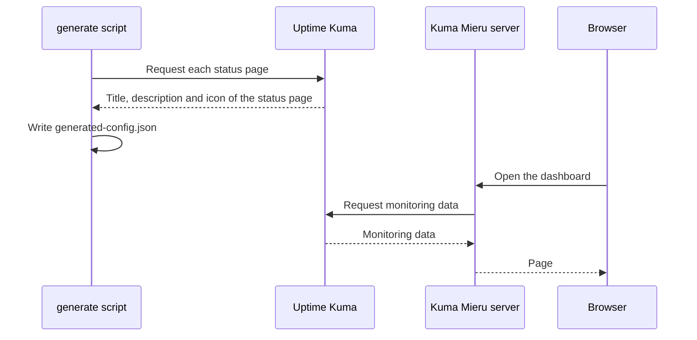

<Callout type="info" title="Version requirement">
  Kuma Mieru is tested and compatible with the latest stable version of Uptime Kuma (v1.23.0 and
  later). If your version is older, upgrade to v1.23.0 or later as described in the [Uptime Kuma
  update guide](https://github.com/louislam/uptime-kuma/wiki/%F0%9F%86%99-How-to-Update). Back up
  your data before you upgrade.
</Callout>

## Preparation

<Steps>
<Step>

### Install Uptime Kuma

Install and configure Uptime Kuma.

</Step>
<Step>

### Set the display time zone

In the Uptime Kuma settings, set `Display Timezone` to a UTC+0 time zone.

The times that the Uptime Kuma backend sends to the frontend carry no time zone information. Kuma Mieru shows all times in UTC+0. If the display time zone is not UTC+0, the times in Kuma Mieru are offset.

</Step>
<Step>

### Create a status page

Create a status page in Uptime Kuma and copy its URL, for example `https://example.kuma-mieru.invalid/status/test1`.

</Step>
<Step>

### Configure the environment variables

Put the status page URL in `UPTIME_KUMA_URLS`:

```ini title=".env"
UPTIME_KUMA_URLS=https://example.kuma-mieru.invalid/status/test1
```

Where you set it depends on the deployment method. See [Environment Variables](./environment.mdx).

</Step>
</Steps>

## Status page URL

Kuma Mieru splits the URL into two parts. The part before `/status/` is the base URL of Uptime Kuma. The segment after `/status/` is the page ID. If Uptime Kuma runs under a subpath, the base URL keeps the path prefix.

| Status page URL                                          | Base URL                                  | Page ID   |
| -------------------------------------------------------- | ----------------------------------------- | --------- |
| `https://example.kuma-mieru.invalid/status/test1`        | `https://example.kuma-mieru.invalid`      | `test1`   |
| `https://example.kuma-mieru.invalid/kuma/status/default` | `https://example.kuma-mieru.invalid/kuma` | `default` |

If a URL has no `/status/<page ID>` part, configuration generation fails.

## Multiple status pages

Separate multiple URLs with `|`. The status pages can come from different Uptime Kuma instances:

```ini title=".env"
UPTIME_KUMA_URLS=https://example.kuma-mieru.invalid/status/default|https://status.kuma-mieru.invalid/status/secondary
```

- The first URL is the default page.
- Each page ID must be unique across all instances. If two instances both have a status page with the page ID `default`, configuration generation fails with an error that starts with `Duplicate page id "default"`. Give the status page in one of the instances a different page ID.

## How Kuma Mieru reads the data



- The `generate` script runs during the build or when the container starts. For the details, see [Choose a Deployment Method](../deploy/index.mdx). If the script cannot reach Uptime Kuma, the title, description and icon come from the environment variables or the defaults.
- The Kuma Mieru server requests the monitoring data from Uptime Kuma at runtime. Thus the environment that runs Kuma Mieru must be able to reach the status page URL.
- If Uptime Kuma uses a self-signed certificate, see [ALLOW_INSECURE_TLS](./environment.mdx#allow_insecure_tls). This variable applies to the runtime requests of the server. It does not apply to the requests of the `generate` script that read the status page metadata. With a self-signed certificate, that step fails, and the title, description and icon come from the environment variables or the defaults.
- You also set the timeout and the retry count of the runtime server requests in [Environment Variables](./environment.mdx).
