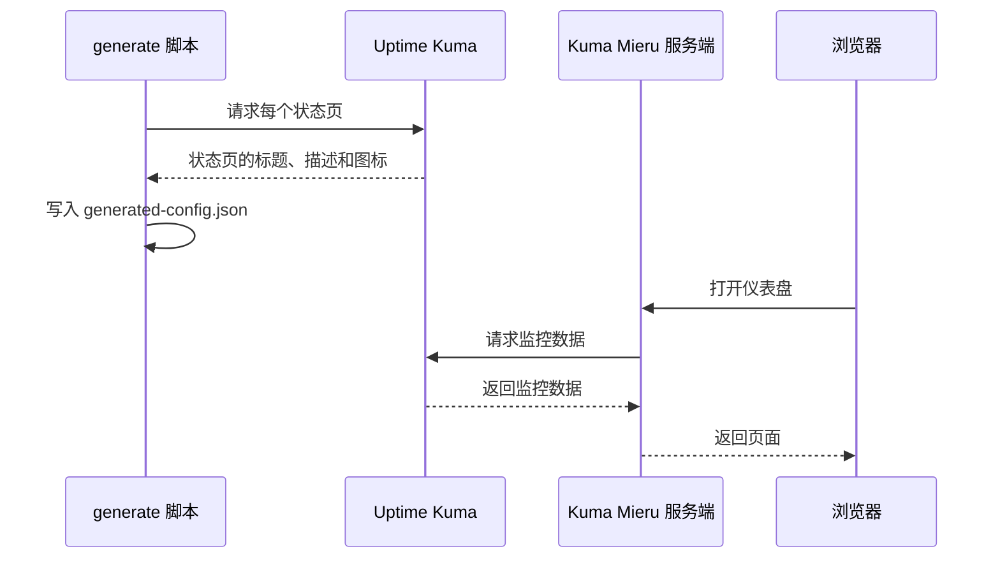

<Callout type="info" title="版本要求">
  经测试，Kuma Mieru 兼容 Uptime Kuma 的最新稳定版本（v1.23.0 及以上）。版本较低时，请参考 [Uptime
  Kuma 官方升级文档](https://github.com/louislam/uptime-kuma/wiki/%F0%9F%86%99-How-to-Update)升级到
  v1.23.0 或以上，升级前先备份数据。
</Callout>

## 准备步骤

<Steps>
<Step>

### 安装 Uptime Kuma

安装并配置 Uptime Kuma。

</Step>
<Step>

### 设置显示时区

在 Uptime Kuma 的设置中，把 `Display Timezone`（显示时区）改为任意 UTC+0 时区。

Uptime Kuma 后端传给前端的时间不带时区信息，Kuma Mieru 统一按 UTC+0 显示时间。显示时区不是 UTC+0 时，Kuma Mieru 中的时间会出现偏移。

</Step>
<Step>

### 创建状态页

在 Uptime Kuma 中创建状态页（Status Page），复制它的 URL，例如 `https://example.kuma-mieru.invalid/status/test1`。

</Step>
<Step>

### 配置环境变量

把状态页 URL 写入 `UPTIME_KUMA_URLS`：

```ini title=".env"
UPTIME_KUMA_URLS=https://example.kuma-mieru.invalid/status/test1
```

设置位置取决于部署方式，见[环境变量](./environment.mdx)。

</Step>
</Steps>

## 状态页 URL

Kuma Mieru 从 URL 中取出两部分：`/status/` 前面的部分是 Uptime Kuma 的基础 URL，`/status/` 后面的一段是页面 ID。Uptime Kuma 部署在子路径下时，路径前缀保留在基础 URL 中。

| 状态页 URL                                               | 基础 URL                                  | 页面 ID   |
| -------------------------------------------------------- | ----------------------------------------- | --------- |
| `https://example.kuma-mieru.invalid/status/test1`        | `https://example.kuma-mieru.invalid`      | `test1`   |
| `https://example.kuma-mieru.invalid/kuma/status/default` | `https://example.kuma-mieru.invalid/kuma` | `default` |

URL 中没有 `/status/<页面 ID>` 时，配置生成失败。

## 多个状态页

用 `|` 分隔多个 URL。这些状态页可以来自不同的 Uptime Kuma 实例：

```ini title=".env"
UPTIME_KUMA_URLS=https://example.kuma-mieru.invalid/status/default|https://status.kuma-mieru.invalid/status/secondary
```

- 第一个 URL 是默认页面。
- 页面 ID 在所有实例之间必须唯一。两个实例都有页面 ID 为 `default` 的状态页时，配置生成失败，报错信息以 `Duplicate page id "default"` 开头。请在其中一个实例中给状态页换一个页面 ID。

## Kuma Mieru 如何读取数据



- `generate` 脚本在构建时或容器启动时运行，时机见[选择部署方式](../deploy/index.mdx)。它访问不到 Uptime Kuma 时，标题、描述和图标使用环境变量的值或默认值。
- Kuma Mieru 的服务端在运行时向 Uptime Kuma 请求监控数据，所以运行 Kuma Mieru 的环境需要能访问状态页 URL。
- Uptime Kuma 使用自签名证书时，见 [ALLOW_INSECURE_TLS](./environment.mdx#allow_insecure_tls)。这个变量作用于服务端运行时的请求，不作用于 `generate` 脚本读取状态页元信息的请求；自签名证书环境中，这一步请求失败，标题、描述和图标使用环境变量的值或默认值。
- 服务端运行时请求的超时与重试次数也在[环境变量](./environment.mdx)中设置。
