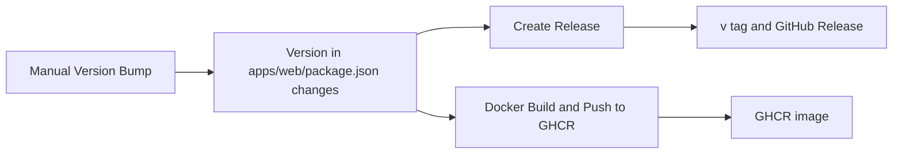

## Recommended tag

<Callout type="warn" title="Use the major version channel">
  For the Docker image, use `ghcr.io/alice39s/kuma-mieru:1` (the major version channel). Do not pin
  a minor or patch version (for example `:1.6` or `:1.6.2`) unless you have a clear canary and
  rollback strategy.
</Callout>

## Compatibility scope

- Within the `v1` major version, the project keeps forward compatibility as much as possible.
- `v2` will contain major breaking changes.

## Image tags

Each time the `Docker Build and Push to GHCR` workflow builds the image, it pushes these tags based on the version in `apps/web/package.json`:

| Tag           | Example            | Points to                                     |
| ------------- | ------------------ | --------------------------------------------- |
| Major version | `1`                | The latest build of this major version        |
| Minor version | `1.6`              | The latest build of this minor version        |
| Full version  | `1.6.2`            | The build of this version                     |
| `latest`      | `latest`           | The latest build of the default branch `main` |
| Commit        | `sha-<short hash>` | The build of one commit                       |

Each tag contains the `linux/amd64` and `linux/arm64` architectures. The workflow builds and pushes the image in these cases:

- `apps/web/package.json`, `Dockerfile`, `docker-compose.yml` or the workflow file changes on the `main` branch.
- A maintainer starts the workflow manually.

## Release process

1. A maintainer runs the `Manual Version Bump` workflow manually and selects `patch`, `minor` or `major`. The workflow updates the version, commits `chore(release): bump version to <version>` and pushes the commit to `main`.
2. The `Create Release` workflow reads the new version. If no release exists for this version, it creates the tag `v<version>` and a GitHub Release. The release notes contain a changelog built from the commits, a list of contributors, and the update procedures for Docker and Docker Compose.
3. The `Docker Build and Push to GHCR` workflow builds the image and pushes the tags in the table above.

## Upgrade

| Deployment method              | How to upgrade                                                                                                                               |
| ------------------------------ | -------------------------------------------------------------------------------------------------------------------------------------------- |
| Docker                         | Pull the new image and recreate the container. See [Docker](../deploy/docker.mdx)                                                            |
| Vercel, Netlify, EdgeOne Pages | Sync your fork on GitHub (`Sync fork`, then `Update branch`). See [Vercel](../deploy/vercel.mdx)                                             |
| Run from source                | Run `git pull` to get the latest code. Then install the dependencies and build again as described in [Run from Source](../deploy/source.mdx) |
