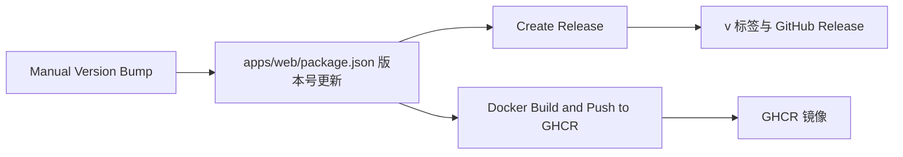

## 推荐的标签

<Callout type="warn" title="使用主版本通道">
  Docker 镜像推荐使用
  `ghcr.io/alice39s/kuma-mieru:1`（主版本通道）。不推荐固定到次版本或补丁版本（例如 `:1.6` 或
  `:1.6.2`），除非你有明确的灰度发布与回滚策略。
</Callout>

## 兼容范围

- `v1` 主版本内尽可能保持向前兼容。
- `v2` 将包含重大的 Breaking Changes。

## 镜像标签

`Docker Build and Push to GHCR` 工作流每次构建镜像时，按 `apps/web/package.json` 中的版本号推送以下标签：

| 标签     | 示例           | 指向                       |
| -------- | -------------- | -------------------------- |
| 主版本   | `1`            | 这个主版本的最新构建       |
| 次版本   | `1.6`          | 这个次版本的最新构建       |
| 完整版本 | `1.6.2`        | 这个版本号的构建           |
| `latest` | `latest`       | 默认分支 `main` 的最新构建 |
| 提交     | `sha-<短哈希>` | 某一次提交的构建           |

每个标签都包含 `linux/amd64` 和 `linux/arm64` 两种架构。工作流在以下情况构建并推送镜像：

- `main` 分支上的 `apps/web/package.json`、`Dockerfile`、`docker-compose.yml` 或工作流文件有改动。
- 维护者手动触发工作流。

## 发布流程

1. 维护者手动运行 `Manual Version Bump` 工作流，选择 `patch`、`minor` 或 `major`。工作流更新版本号，提交 `chore(release): bump version to <版本号>`，再推送到 `main`。
2. `Create Release` 工作流读取新的版本号。这个版本还没有 Release 时，它创建标签 `v<版本号>` 和对应的 GitHub Release。Release 说明包含按提交生成的更新日志、贡献者列表，以及 Docker 和 Docker Compose 的更新方法。
3. `Docker Build and Push to GHCR` 工作流构建镜像，并按上表推送标签。

## 升级

| 部署方式                       | 升级方法                                                                                        |
| ------------------------------ | ----------------------------------------------------------------------------------------------- |
| Docker                         | 拉取新镜像并重新创建容器，见 [Docker](../deploy/docker.mdx)                                     |
| Vercel、Netlify、EdgeOne Pages | 在 GitHub 上同步 Fork（`Sync fork`，再点击 `Update branch`），见 [Vercel](../deploy/vercel.mdx) |
| 从源码运行                     | 运行 `git pull` 获取最新代码，再按[从源码运行](../deploy/source.mdx)重新安装依赖并构建          |
