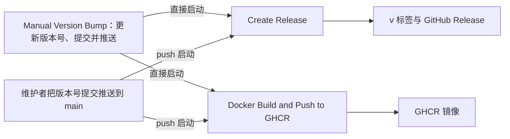

## 推荐的标签

<Callout type="warn" title="使用主版本通道">
  Docker 镜像推荐使用
  `ghcr.io/alice39s/kuma-mieru:1`（主版本通道）。不推荐固定到次版本或补丁版本（例如 `:1.6` 或
  `:1.6.2`），除非你有明确的灰度发布与回滚策略。
</Callout>

## 兼容范围

- `v1` 主版本内尽可能保持向前兼容。
- `v2` 将包含重大的 Breaking Changes。

## 镜像标签

`Docker Build and Push to GHCR` 工作流按 `apps/web/package.json` 中的版本号给镜像打以下标签：

| 标签     | 示例           | 指向                       |
| -------- | -------------- | -------------------------- |
| 主版本   | `1`            | 这个主版本的最新构建       |
| 次版本   | `1.6`          | 这个次版本的最新构建       |
| 完整版本 | `1.6.2`        | 这个版本号的构建           |
| `latest` | `latest`       | 默认分支 `main` 的最新构建 |
| 提交     | `sha-<短哈希>` | 某一次提交的构建           |

每个标签都包含 `linux/amd64` 和 `linux/arm64` 两种架构。工作流在以下情况运行：

| 触发方式                                                                                           | 构建镜像 | 推送标签 |
| -------------------------------------------------------------------------------------------------- | -------- | -------- |
| 推送到 `main`，并且改动了 `apps/web/package.json`、`Dockerfile`、`docker-compose.yml` 或工作流文件 | 是       | 是       |
| 手动运行，或由 `Manual Version Bump` 启动                                                          | 是       | 是       |
| 指向 `main` 的 Pull Request 改动了 `apps/web/package.json` 或 `Dockerfile`                         | 是       | 否       |

## 发布流程

1. 维护者手动运行 `Manual Version Bump` 工作流，选择 `patch`、`minor` 或 `major`。工作流更新 `apps/web/package.json` 的版本号，提交 `chore(release): bump version to <版本号>` 并推送，然后直接启动 `Create Release` 和 `Docker Build and Push to GHCR`。
2. 维护者也可以自己修改 `apps/web/package.json` 的版本号，把提交推送到 `main`。这时两个工作流由 push 启动。
3. `Create Release` 读取 `apps/web/package.json` 的版本号。当前版本号与最新一个 Release 的版本不同时，它创建标签 `v<版本号>` 和对应的 GitHub Release。Release 说明包含按提交生成的更新日志、贡献者列表，以及 Docker 和 Docker Compose 的更新方法。
4. `Docker Build and Push to GHCR` 构建镜像，并按上表推送标签。

## 升级

| 部署方式                       | 升级方法                                                                                        |
| ------------------------------ | ----------------------------------------------------------------------------------------------- |
| Docker                         | 拉取新镜像并重新创建容器，见 [Docker](../deploy/docker.mdx)                                     |
| Vercel、Netlify、EdgeOne Pages | 在 GitHub 上同步 Fork（`Sync fork`，再点击 `Update branch`），见 [Vercel](../deploy/vercel.mdx) |
| 从源码运行                     | 运行 `git pull` 获取最新代码，再按[从源码运行](../deploy/source.mdx)重新安装依赖并构建          |
